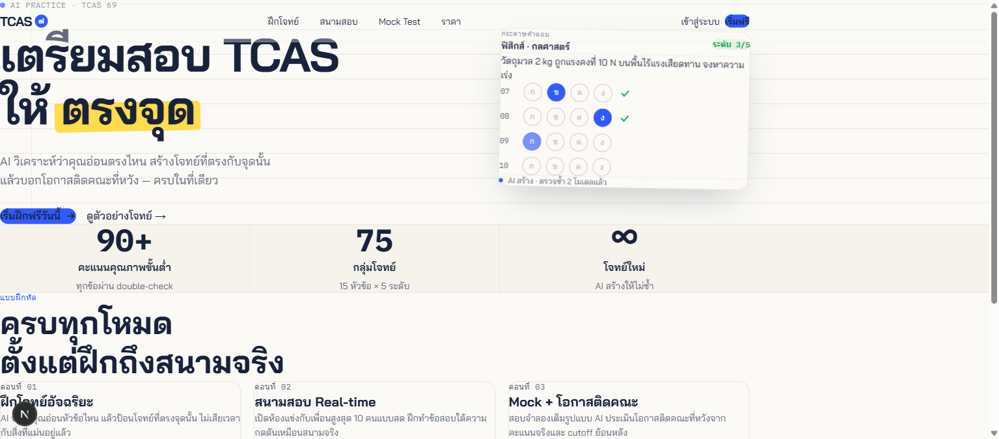

# TCAS AI Practice App

> **Status: archived (not launched).** The whole MVP got built, all the way to the pre-launch checklist, but I shelved it on purpose. AI tools are improving so fast that a standalone "AI-generated exam practice" product would probably be disrupted before it could earn back its cost. The repo stays up as a record of how the system was designed and built.

A subscription web app that uses **AI to generate practice questions** for TCAS, Thailand's university entrance exam. v1 covered Math and Physics. It adapts to each student's level, has realtime study rooms with friends, and runs full mock exams that estimate admission chances.

I built it solo, so every decision had to answer one question: *can one person run this?*



---

## Highlights

### Content pipeline built around correctness
If the questions are wrong, the app is worthless. Generated questions go through this flow (the generation stage is designed, while the quality, report and promotion machinery after it is implemented in SQL):

```
Claude generates → independent blind-solve (no answer key) → answers match? pass (confidence 70)
                                                            → mismatch?     regenerate
```

- **Confidence score (0–100)** for each question. It changes based on user reports, and each report is weighted by that reporter's past accuracy, so trusted reporters count for more.
- **Tiered by stakes:** practice questions that fall below the floor are auto-removed. Mock-exam questions (90+) go to a human review queue and are never removed automatically.
- **Promotion 70 → 90+** depends on usage, report rate, rating and calibration certainty.

### Two-layer adaptive difficulty (Glicko-2 style)
- **True rank** moves slowly. It is the persistent ability estimate per topic, so one noisy session can't swing it much.
- **Serving difficulty** moves fast and picks the next question within a session.
- Each question has a **difficulty level** (a stable bucket) and a **difficulty value** (calibrated over time, with RD). Every attempt is a two-way match that updates both the user and the question.
- **Cold-start anchor:** a question's difficulty value stays frozen until enough low-RD users have attempted it, so uncertain users and uncertain questions don't calibrate against each other.

### Cost-aware by design
- Designed so batch generation keeps the question bank topped up ahead of demand, with real-time generation only as a capped **escape hatch** for when a user's pool is about to run dry. A cost guardrail module enforces spend limits on that path.
- **One home per rule** ([ADR-0001](docs/adr/0001-one-home-per-rule.md)): scheduled jobs (token grants, quality recompute, promotion flags) live only in SQL and run on `pg_cron`. There are no TypeScript mirrors that could drift, and no paid scheduler.
- Seed bank import/export scripts let the first question bank be generated cheaply before switching to the API.

### Monetization
- **Reverse trial:** full access for a short trial, then a permanent free tier (practice only) or a paid tier.
- **One-way token economy:** social tokens can convert to practice tokens at 1:0.5, but not the other way. Balances are capped at 7 days of grants.
- Payments via **Omise** (PromptPay / TrueMoney / card), with idempotent webhook handling.

---

## Tech stack

| Layer | Choice |
|---|---|
| Web | Next.js 16 (App Router, TypeScript), Tailwind CSS v4 |
| Data / Auth / Realtime | Supabase (Postgres, RLS, `pg_cron`) |
| AI | Claude: seed bank generated offline via Claude Code; the API Batch pipeline is designed and cost-guarded but not wired up yet |
| Payments | Omise |
| Observability | Sentry, PostHog |
| Email | Resend |
| Testing | Vitest (unit + integration against local Supabase), Playwright (e2e + axe a11y) |

## What's in here

```
tcas-app/
  src/app/              # routes: practice, social rooms, mock exam, upgrade, auth, legal
  src/lib/              # domain modules: calibration, quality, tokens, billing, mock, social…
  supabase/migrations/  # 15 migrations: content, calibration, tokens/subs, social, quality, RLS…
  tests/unit/           # 37 Vitest suites (many hit a real local Postgres)
  tests/e2e/            # Playwright smoke, practice flow, accessibility
docs/
  superpowers/specs/    # full MVP design doc (Thai)
  adr/                  # architecture decision records
CONTEXT.md              # domain glossary (Thai)
tcas-app-product-doc.md # product doc (Thai)
TCAS Financial Model.xlsx + build_model.py  # unit economics / runway model
```

## Running locally

See [`tcas-app/README.md`](tcas-app/README.md). In short: `pnpm install`, then `pnpm supabase start` (Docker required), copy the keys into `.env.local`, then `pnpm supabase db reset` and `pnpm dev`.

## Why it stopped

Getting users to convert to paid was always the biggest risk. The design kept spending low (small question bank, organic growth, no paid acquisition) so that risk could be tested cheaply. In the end the bigger risk came from outside the product: general-purpose AI assistants can already generate and explain exam-style questions on demand, so a standalone app has a shrinking window to build an edge.
